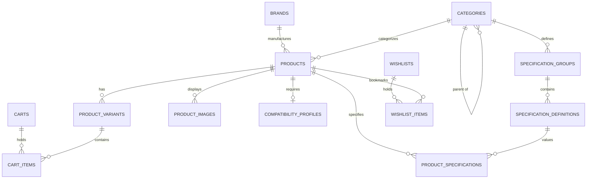

# Sound Supply

> **Everything you need to make sound.**

Sound Supply is a modern online music equipment and audio production commerce platform engineered specifically for the Indian market. Inspired by the depth, product discoverability, information architecture, and technical seriousness of Sweetwater, Sound Supply features an original visual identity, editorial UX, and robust relational data architecture tailored for Indian musicians, bedroom producers, recording engineers, podcasters, and DJs.

---

## 🎵 Brand & Design Philosophy

Sound Supply is designed around **helping customers choose gear with confidence**, rather than merely displaying catalog listings.

* **Light-First Professional Retail:** Clean `#F7F7F5` canvas with crisp `#DDDDDD` borders, restrained 4–10px radii, subtle elevation, and a signature warm crimson flame accent (`#D9381E`).
* **Technical Transparency:** Category-specific specification taxonomy instead of generic flat attribute tables.
* **Signal Chain Awareness:** Hardware compatibility—inputs, outputs, +48V phantom power, preamp gain headroom, and headphone impedance matching.
* **Accurate Money Architecture:** Financial transactions and pricing stored in integer paise (`price_inr_paise`), eliminating floating-point rounding errors while formatting cleanly in Indian Rupees (`formatInr`).
* **Decoupled Business Policies:** All delivery, warranty, and authenticity claims are driven by a centralized policy configuration (`src/config/siteConfig.ts`), avoiding hardcoded factual assumptions.

---

## 🗄️ Phase 2: Catalog & Data Architecture

Phase 2 transitions Sound Supply from a static storefront to a **production-ready relational data architecture**.

### 1. Relational PostgreSQL Schema (`supabase/migrations/`)
* **`brands`**: Verified manufacturers, country of origin, warranty periods, and featured status.
* **`categories` & `category_groups`**: Hierarchical category tree and mega-menu organization.
* **`products`**: Normalized product parent models with descriptive features, box contents, and ratings.
* **`product_variants`**: Distinct SKUs, finishes, driver sizes, impedance ratings, and **prices in integer paise** (`mrp_inr_paise`, `price_inr_paise`).
* **`product_images`**: Multi-angle image galleries linked to products and specific variants.
* **`specification_groups` & `specification_definitions`**: Relational taxonomy matching pro audio domains (AD/DA Conversion, Preamps & Headroom, Transducer Acoustics, I/O Routing, DAW Control).
* **`product_specifications`**: Product-specific technical values linked to definitions.
* **`compatibility_profiles`**: Signal-chain connectors, +48V phantom power requirements, minimum preamp gain, and headphone impedance driving capabilities for the Studio Builder engine.
* **`carts` & `cart_items`**: Server-validated guest and user carts linked via session tokens.
* **`wishlists` & `wishlist_items`**: Shortlist bookmarking linked via session tokens.
* **Row Level Security (RLS)**: Public read-only access for catalog tables; secure session token matching for carts and wishlists.

### 2. Relational Entity Relationship Diagram



### 3. Decoupled Service Layer (`src/services/`)
Data access is isolated behind an asynchronous service layer with transparent fallback:
* **`productService`**: Multi-facet filtering (brands, price, stock, tags), sorting (`price-asc`, `price-desc`, `rating`), pagination, and related product resolution.
* **`categoryService`**: Category tree, subcategories, and navigation hierarchy.
* **`brandService`**: Alphabetical manufacturer directory and featured brand queries.
* **`searchService`**: Instant multi-field fuzzy search across titles, brands, categories, and technical specifications with autocomplete suggestions.
* **`cartService`**: Server-side variant price validation, preventing client-side price tampering.
* **`wishlistService`**: Session-persisted wishlist bookmarks.

### 4. Supabase Client Integration
* Configured via `.env.example` (`NEXT_PUBLIC_SUPABASE_URL`, `NEXT_PUBLIC_SUPABASE_ANON_KEY`, `SUPABASE_SERVICE_ROLE_KEY`).
* Client singleton in `src/lib/supabase/client.ts`.
* Next.js 15+ Server Component client in `src/lib/supabase/server.ts` with asynchronous cookie handling.
* **Resilient Fallback Mode:** When cloud credentials are not supplied, all services transparently query the verified 36-product seed dataset (`src/data/seedData.ts`), guaranteeing 100% build and offline dev reliability.

---

## ⚡ Core Features & User Experience

### 1. Universal Search & Autocomplete
* Centered search bar dominating the global header.
* Keyboard navigation (`ArrowUp`, `ArrowDown`, `Enter`, `Escape`).
* Categorized autocomplete results: Matching Equipment, Categories, and Brands.
* Popular searches quick-picker for empty query state.

### 2. Multi-Level Navigation & 4-Column Mega-Menu
* **Utility Bar:** Displays storefront policy indicators and technical advice contacts.
* **Global Header:** Logo mark, dominant search, compare shortcut, wishlist, account, and studio cart.
* **Department Mega-Menu:**
  * *Column 1:* Department overview, description, and genuine hardware guarantee notice.
  * *Column 2:* Major core recording equipment.
  * *Column 3:* Subcategories & acoustic accessories.
  * *Column 4:* Featured brands directory & signal setup guide spotlight.

### 3. Retail-Standard Product Card
Engineered for rapid scanning and commerce clarity:
```text
BRAND (uppercase monospace label)
[ PRODUCT IMAGE ] (clean container with badge overlays)
PRODUCT NAME (2-line clamp)
★★★★★ 123 (ratings & review count)
2–3 SELECTIVE TECH SPECS (e.g. 24-bit/192kHz, 69dB Gain, 2x2 I/O)
₹XX,XXX  MRP ₹XX,XXX  XX% OFF
● In Stock (emerald indicator)
[ Add to Cart ] (full-width primary CTA with feedback state)
♡ Saved  |  ⚖ Compare (compact bottom action row)
```

### 4. Deep Product Detail Page (PDP)
* **Multi-Angle Gallery:** Primary viewport with thumbnail rail.
* **Variant Architecture:** Clean switching between SKU variants (finishes, driver sizes, impedances, bundle editions).
* **Indian Pincode Checker:** 6-digit postal code validation for delivery SLA estimation.
* **Structured Specifications:** Category-specific groups (AD/DA Conversion, Preamps, I/O Routing, Acoustic Enclosures).
* **Signal Chain & Hardware Compatibility Flowchart:**
  * Visual signal routing diagram:
    ```text
    [ Source / Transducer ] ──(Balanced 3-Pin XLR)──► [ Interface / Preamp ] ──(Line Out TRS)──► [ Active Monitors / Cans ]
    ```
  * Verified status checkpoints:
    * `✓ Requires +48V Phantom Power` / `✓ Provides +48V Phantom Power`
    * `✓ Compatible Connector: Balanced XLR / 1/4" TRS`
    * `⚠ Recommended Preamp Gain: ≥ 60 dB`
    * `✓ Headphone Driving Impedance: 16Ω – 300Ω`
    * `✓ Power: USB-C Bus-Powered`

### 5. Interactive Studio Builder (`/studio-builder`)
* **"WHAT ARE YOU BUILDING?"** goal selector: Bedroom Studio, Producer Setup, Vocal Recording, Home Band, or Commercial Facility.
* **"YOUR SETUP"** hardware slots: Microphone, Audio Interface, Headphones, Monitors, and Accessories with compatibility tags and live estimated totals.

### 6. Side-by-Side Comparison Engine (`/compare`)
* Unobtrusive docked comparison tray (`CompareDrawer.tsx`) supporting up to 4 items.
* Comprehensive spec matrix with a **"Highlight Differences Only"** toggle and subtle `Diff` badges on distinct attributes.

### 7. Structured A–Z Brand Directory (`/brands`)
* Alphabetical manufacturer index (AKAI, AKG, ADAM Audio, Arturia, Audio-Technica, Beyerdynamic, Fender, Focusrite, Genelec, KRK, Lewitt, Mogami, MOTU, Native Instruments, Neumann, Novation, PRS, RØDE, Sennheiser, Shure, SSL, Universal Audio, Yamaha).

---

## 🛠️ Tech Stack

* **Framework:** [Next.js](https://nextjs.org/) (App Router, React 19)
* **Database & Auth:** [Supabase](https://supabase.com/) (PostgreSQL 15+, Row Level Security)
* **Language:** [TypeScript](https://www.typescriptlang.org/) (Strict mode)
* **Styling:** [Tailwind CSS](https://tailwindcss.com/) with centralized design tokens
* **Icons:** [Lucide React](https://lucide.dev/)
* **Typography:** `Inter` (UI sans) + `Space Grotesk` (Technical display / monospace numerals)

---

## 📁 Project Structure

```text
sound-supply/
├── src/
│   ├── app/                          # Next.js App Router routes
│   │   ├── layout.tsx                # Root layout, fonts, CommerceProvider
│   │   ├── page.tsx                  # 8-module Homepage
│   │   ├── categories/               # Category tree & dynamic [slug] PLP
│   │   ├── products/                 # Dynamic [slug] PDP with Signal Chain UI
│   │   ├── brands/                   # A-Z Brand Directory & [slug] pages
│   │   ├── studio-builder/           # Interactive hardware setup harmonizer
│   │   ├── compare/                  # Side-by-side specification matrix
│   │   ├── deals/                    # Promotions and studio packages
│   │   ├── guides/                   # Buying guides and technical advice
│   │   ├── cart/                     # Validated studio cart with quantity controls
│   │   ├── wishlist/                 # Saved gear shortlist
│   │   └── search/                   # Search results page
│   ├── components/
│   │   ├── layout/                   # Header, UtilityBar, Footer, MobileBottomNav
│   │   ├── navigation/               # CategoryNav, MegaMenu, Breadcrumbs
│   │   ├── product/                  # ProductCard (retail hierarchy)
│   │   ├── search/                   # SearchBar (combobox, keyboard nav)
│   │   ├── comparison/               # CompareDrawer
│   │   ├── filters/                  # FilterSidebar (facets & mobile drawer)
│   │   ├── home/                     # Homepage section modules
│   │   └── ui/                       # Base primitives (Logo, Badge, RatingStars, Skeleton, EmptyState)
│   ├── config/
│   │   └── siteConfig.ts             # Centralized business policies & brand configuration
│   ├── context/
│   │   └── CommerceContext.tsx       # Session-backed state (validated cart, wishlist, compare)
│   ├── data/
│   │   ├── seedData.ts               # 35+ verified pro audio products with integer paise pricing
│   │   ├── products.ts               # Re-exports seed catalog for backward compatibility
│   │   ├── categories.ts             # Department taxonomy and subcategories
│   │   ├── brands.ts                 # 29 verified manufacturers
│   │   ├── presets.ts                # Studio Builder configuration presets
│   │   ├── guides.ts                 # Editorial buying guides
│   │   └── specTemplates.ts          # Category-specific technical spec definitions
│   ├── lib/
│   │   ├── currency.ts               # Strict integer paise arithmetic and INR formatting
│   │   ├── utils.ts                  # cn helper, calculations
│   │   └── supabase/                 # Supabase client (client.ts) and server (server.ts)
│   ├── services/                     # Decoupled domain service layer
│   │   ├── productService.ts         # Faceted queries, sorting, pagination
│   │   ├── categoryService.ts        # Category hierarchy
│   │   ├── brandService.ts           # Manufacturer directory
│   │   ├── searchService.ts          # Multi-field search and auto-complete
│   │   ├── cartService.ts            # Server-side price validation & session cart
│   │   └── wishlistService.ts        # Shortlist bookmarks
│   └── types/
│       ├── database.ts               # PostgreSQL table row types
│       └── index.ts                  # Core domain model (Product, Variant, CompatibilityProfile)
├── supabase/
│   ├── migrations/                   # PostgreSQL DDL migrations with RLS & indexes
│   └── seed.sql                      # SQL seed file for Supabase database reset
├── scripts/
│   └── test-catalog.ts               # 31-point automated verification test suite
├── tailwind.config.ts                # Design tokens (colors, borders, radii, typography)
├── .env.example                      # Documented environment variables
└── package.json
```

---

## 🚀 Getting Started

### Prerequisites
* [Node.js](https://nodejs.org/) v18.18 or higher (v20+ recommended)
* `npm` or `yarn` / `pnpm`

### Installation
```bash
git clone https://github.com/me-hv/sound-supply.git
cd sound-supply
npm install
```

### Environment Setup (Optional)
Copy `.env.example` to `.env.local` to connect to a live Supabase project:
```bash
cp .env.example .env.local
```
*(If no Supabase credentials are provided, Sound Supply automatically runs in resilient in-memory fallback mode using the comprehensive 36-item seed catalog).*

### Running Verification Tests
```bash
npm run test:catalog
```
Executes the 31-point test suite validating currency math, paise integer integrity, product filters, search multi-field matching, and cart tampering prevention.

### Type Check & Build
```bash
npm run typecheck
npm run build
npm run start
```

---

## 📄 License

This project is proprietary and developed for Sound Supply India. All brand names, logos, and trademarks referenced belong to their respective manufacturers.
